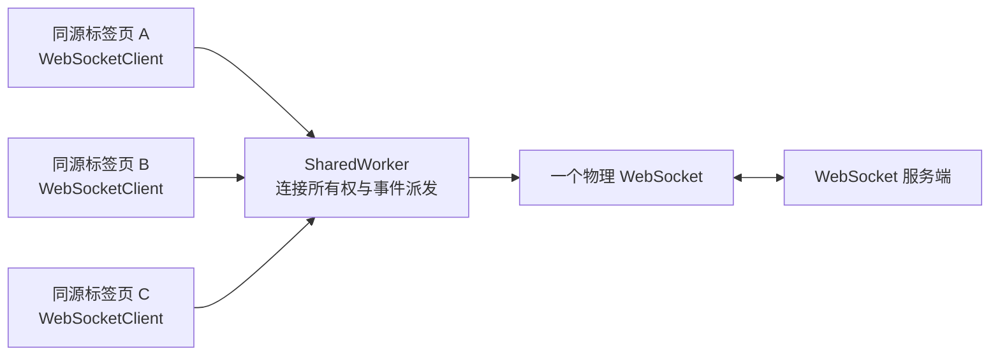

# SocketFuse

> 以 SharedWorker 为首选，在同源浏览器标签页之间复用 WebSocket 物理连接。

`socketfuse` 是一个框架无关的浏览器端 WebSocket 库。多个同源页面使用相同连接 `id` 和共享配置时，会通过
一个 SharedWorker 接入同一个物理 WebSocket；每个页面仍拥有独立的 client、事件处理器、生命周期和错误边界。
它适用于即时通信、行情、协作编辑、通知流等需要多标签页实时连接的场景。

当前仓库正在准备 `socketfuse@0.0.1-beta.1` 首发，npm 使用 `beta` dist-tag；公开包名、入口与 API 已固定为
`socketfuse`、`socketfuse/protocol` 和 `socketfuse/worker`。

## 为什么使用 SocketFuse

- 降低连接数：同一浏览器、同一源、相同 `id` 的页面最多复用一个物理 WebSocket。
- 保持页面隔离：每个页面获得稳定的 `WebSocketClient` 实例，可动态注册 `onMessage` 处理器。
- 零配置可用：默认使用内联 SharedWorker；不需要单独部署 Worker 文件。
- 可控的降级：SharedWorker 构造或初始化失败时，可选择当前页面的 direct WebSocket 或直接报错。
- 覆盖常见连接能力：重连、队列与背压、JSON/自定义协议、认证 revision、心跳、诊断、生命周期回放。
- 明确交付边界：`sendMessage()` 成功表示本地已接纳或入队，不表示服务端已收到；库不提供 RPC 或服务端 Ack。

## 运行模型



共享身份由 `id` 与共享连接配置共同决定。相同 `id` 使用不同 URL、协议、重连、心跳等共享配置时，不会静默
覆盖，而会以配置冲突失败。`id` 只用于连接复用，不是授权边界；认证仍应由服务端和应用协议负责。

## 快速开始

首次发布后可安装公开包：

```sh
pnpm add socketfuse
```

在浏览器页面中创建并打开连接：

```ts
import { createWebSocket } from 'socketfuse'

const ws = createWebSocket('wss://api.example.com/realtime', {
  id: 'realtime:user-42',
  onMessage: (_client, event) => {
    console.log('message', event.data, { replayed: event.replayed })
  },
})

await ws.open()

const receipt = await ws.sendMessage(JSON.stringify({
  type: 'presence',
  online: true,
}))

console.log(receipt.status) // accepted 或 queued
```

原始模式只接受原生 WebSocket 数据：`string`、`Blob`、`ArrayBuffer` 或类型化数组视图。发送 JSON 对象时，显式
选择 JSON 协议：

```ts
const ws = createWebSocket('wss://api.example.com/events', {
  id: 'events:user-42',
  protocol: { type: 'json' },
})

await ws.open()
await ws.sendMessage({ type: 'subscribe', channel: 'notifications' })
```

完整配置、事件、错误语义和协议示例见[文档站](packages/docs/site/index.md)。

## API 概览

| 入口 | 用途 |
| --- | --- |
| `socketfuse` | `createWebSocket`、client、配置、状态、事件和错误类型。 |
| `socketfuse/protocol` | `rawProtocol` 与自定义 `ProtocolAdapter` 契约。 |
| `socketfuse/worker` | 自定义 SharedWorker 部署所需的 runtime 创建与暴露函数。 |

`createWebSocket(url, options)` 返回一个稳定的 `WebSocketClient`。常用成员包括：

- `open()` / `close()` / `dispose()`：参与、离开或永久释放当前页面的逻辑 client。
- `sendMessage(data)`：提交消息并获得本地接纳回执。
- `onMessage(handler)`：动态注册页面本地消息处理器，并返回取消函数。
- `updateAuth()` / `clearAuth()` / `updateUrl()`：通过单调递增 revision 更新共享认证或 endpoint。
- `diagnostics()`：读取不包含 payload、token、查询参数和内部异常详情的运行指标。

签名与完整行为以 [API 参考](packages/docs/site/api/index.md)为准。

## 能力与边界

| 范围 | 行为 |
| --- | --- |
| Worker 降级 | 仅在 SharedWorker API 不可用、构造、加载或初始化握手失败时按 `fallback` 降级。已选 transport 的网络或恢复失败不会静默切换。 |
| 生命周期 | `lifecycle.restore` 默认关闭。启用后可在页面隐藏/冻结期间有限缓存消息，并在恢复时以 `replayed: true` 派发。它不是持久化消息恢复。 |
| 协议 | 支持 raw、声明式 JSON 与自定义 adapter。自定义 adapter 需在自定义 Worker 中静态注册，不能通过 `MessagePort` 传递函数。 |
| 队列与背压 | 默认不离线缓存。显式开启后，消息仍受数量与字节上限限制；溢出会有明确错误或事件，而不会无限占用内存。 |
| SSR | 三个公开入口可在 Node/SSR 中安全 import；实际创建 client 必须在浏览器页面 realm。 |
| 安全 | 诊断与 Worker 控制协议不会暴露认证值、URL 查询参数、业务 payload 或内部异常文本。 |

浏览器兼容性与 CSP/自定义 Worker 部署要求见[兼容性与安全](packages/docs/site/reference/compatibility-and-security.md)。

## 文档与仓库导航

- [使用指南](packages/docs/site/guide/index.md)：连接共享、可靠性、生命周期恢复与 Worker 降级。
- [协议指南](packages/docs/site/protocols/index.md)：raw、JSON 与自定义 adapter。
- [配置参考](packages/docs/site/reference/configuration.md)：连接、队列、背压、重连和生命周期选项。
- [API 参考](packages/docs/site/api/index.md)：从 TypeDoc 生成的公开签名与说明。
- [演练场](packages/docs/site/playground.md)：在本地测试共享连接、降级、回放和二进制消息。
- [SocketFuse 更名规格](docs/specs/socketfuse-renaming-spec.md)：包名、入口和外部平台的迁移边界。

## 本地开发

本仓库使用 pnpm workspace 管理。建议使用 Node `^22.18.0 || >=24.11.0` 与锁定的 pnpm `10.34.5`。

```sh
pnpm install
pnpm dev                 # 启动文档站与内嵌演练场
pnpm playground:server   # 启动本地 WebSocket 测试服务
```

常用验证命令：

```sh
pnpm check:static   # ESLint 与全仓 typecheck
pnpm check:runtime  # 单测、构建、文档与发布 tarball 验收
pnpm test:e2e       # Chromium、Firefox、WebKit
pnpm check          # static + runtime
```

不要并行运行 `pnpm check` 与 `pnpm test:e2e`：两者都构建 `packages/socketfuse/dist`，本地同时执行会干扰
Playground 的开发服务器。

仓库实现边界、中文注释约定和模块依赖方向见 [AGENTS.md](AGENTS.md) 与 [CLAUDE.md](CLAUDE.md)。私有运行时、
文档与测试工程分别见 [@socketfuse/core](packages/core/README.md)、[文档 workspace](packages/docs/README.md) 和
[测试 workspace](packages/test/README.md)。

## 贡献与发布

面向使用者的 `socketfuse` 改动需要随业务 PR 提交 Changeset。Changeset 合并后，release workflow 会创建
`chore(release): version socketfuse` Version Packages PR；该 PR 通过发布包验收并合并后，受保护的 GitHub `npm`
Environment 才会通过 npm Trusted Publishing/OIDC 发布 `socketfuse`。

仓库不保存长期 npm token，也不支持本地或递归发布。贡献要求、required check、GitHub App、npm Trusted Publisher
和首次发布配置见 [CONTRIBUTING.md](CONTRIBUTING.md)。

## 许可证

[MIT](packages/socketfuse/LICENSE)
