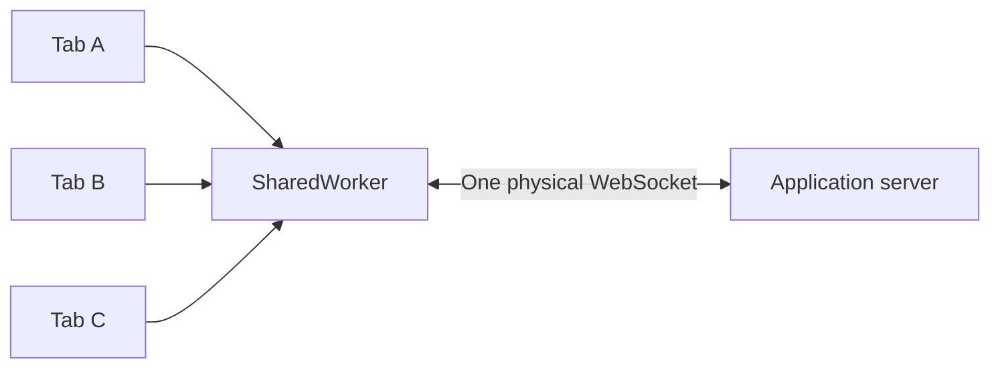

# SocketFuse

[](https://www.npmjs.com/package/socketfuse)
[](packages/socketfuse/LICENSE)

**English** · [简体中文](README.zh-CN.md)

Share WebSocket connections across same-origin browser tabs, with SharedWorker as the default transport.

SocketFuse is for applications that receive live data in multiple tabs, such as notifications, market feeds, and collaboration tools. Clients using the same `id` and shared configuration in one SharedWorker reuse one physical connection, while each page keeps its own callbacks and lifecycle. It is framework agnostic, includes TypeScript types, and has no third-party runtime dependencies.

Check the [changelog](packages/socketfuse/CHANGELOG.md) before upgrading. Repository documentation follows main. Chinese documentation is the source of truth; this README is maintained alongside it.

## Features

- **Shared connections**: reuse the socket, heartbeat, send queue, and reconnect budget across tabs; reject conflicting configurations.
- **Inline Worker by default**: no separate Worker deployment required; use a static same-origin Worker for CSP requirements and custom protocols.
- **Connection-level protocol handling**: define application receipts, control-frame filtering, and business projections in the Worker, once per physical frame.
- **Bounded resources**: limits for send queues, port delivery, pending operations, and lifecycle replay.
- **Per-page dispatch**: ordinary handlers run in each page; `dispatchKey` selects one recipient for a frame.
- **Explicit fallback**: an inline Worker initialization failure can select page-local direct transport; network failures never switch an established transport.

## Installation

```sh
pnpm add socketfuse
```

You can also use `npm install socketfuse` or `yarn add socketfuse`.

## Quick start

Create a client in a browser page. This example uses JSON and explicitly controls the first connection:

```ts
import { createWebSocket } from 'socketfuse'

const ws = createWebSocket('wss://api.example.com/events', {
  id: 'events:user-42',
  protocol: { type: 'json' },
  immediate: false,
  onError: (_client, error) => console.error(error.code),
})

const unsubscribe = ws.onMessage((event) => {
  console.log(event.data, { replayed: event.replayed })
})

await ws.open()
const receipt = await ws.sendMessage({ type: 'subscribe', channel: 'notifications' })
console.log(receipt.status) // accepted or queued

// Release registrations and resources when this page no longer needs the client.
unsubscribe()
await ws.dispose()
```

Replace the example URL with your WebSocket server. Use the same `id`, shared configuration, and Worker deployment in another same-origin tab to join the existing connection. Your server defines the subscription message used in this example.

Omitting `protocol` selects raw mode, which accepts strings, Blobs, ArrayBuffers, and typed-array views. `immediate` defaults to `true`; set it to `false` to register callbacks and reconnect hooks before calling `open()`. `close()` ends this page's participation and allows another `open()`; `dispose()` permanently releases the client.

A successful `sendMessage()` means local acceptance or queueing, not server delivery. If the send confirmation is lost, `SEND_OUTCOME_UNKNOWN` does not prove that the message was never sent.

## Sharing and protocol boundaries



Sharing is scoped to one SharedWorker instance, including its origin, Worker URL, name, and browser partition. `id` identifies a shared connection; it is not an authorization credential. Incompatible protocol, reconnect, or resource settings for the same `id` fail with `CONNECTION_CONFIG_CONFLICT`.

The initial URL is not part of the shared identity. A joining page's URL does not replace an existing endpoint; use a reconnect preparation hook to update it. Authentication, application readiness, cursors, and idempotency belong to your application protocol.

| Capability | Contract |
| --- | --- |
| Reconnection | Page requests, Worker requests, and automatic recovery share `reconnect.maxRetries`; `countAsRetry: false` exempts one attempt without resetting the budget. |
| Worker extensions | Synchronous `onFrame` can consume, reply, project data, and request reconnection; the Worker never waits for page handlers. |
| `dispatchKey` | Selects at most one recipient per frame and key; it does not guarantee mutual exclusion of asynchronous side effects or run for replayed messages. |
| Replay | Opt-in, bounded, per-page storage of in-memory business projections; it cannot recover history after a Worker restart. |
| Direct transport | Uses the same runtime and resource limits, with sharing restricted to the current page realm. |
| Custom Worker | Initialization failures are explicit errors; direct fallback cannot discard custom protocol behavior. |

## Browser support and deployment

All three public entry points are safe to import in SSR or Node. Creating a client requires a browser page. SharedWorker availability, page freezing, and storage partitioning vary by browser; CI runs Chromium, Firefox, and WebKit.

The default inline Worker uses a `data:` URL. If your CSP disallows it, deploy a static same-origin Worker and check your WebSocket server's Origin and authentication policy. See [fallback and Worker deployment](packages/docs/site/guide/fallback-and-worker.md) and [compatibility and security](packages/docs/site/reference/compatibility-and-security.md) (Chinese).

## Documentation

Product guides and API comments are maintained in Chinese. Follow the contributing guide to run the documentation site locally.

| Guide | Contents |
| --- | --- |
| [Getting started](packages/docs/site/guide/getting-started.md) | Installation, connection, sending, and cleanup |
| [Connection sharing](packages/docs/site/guide/connection-sharing.md) | Shared identity, conflicts, and page dispatch |
| [Reliability](packages/docs/site/guide/reliability.md) | Reconnect budgets, queues, backpressure, and heartbeat |
| [Worker extensions](packages/docs/site/guide/worker-extensions.md) | Application receipts, projections, and connection preparation |
| [Lifecycle and replay](packages/docs/site/guide/lifecycle-and-replay.md) | Page suspension, recovery, and message boundaries |
| [Configuration](packages/docs/site/reference/configuration.md) | Scopes, defaults, and resource limits |
| [API reference](packages/docs/site/api/index.md) | Full types for all three entry points in the generated documentation site |

The public entry points are `socketfuse`, `socketfuse/protocol`, and `socketfuse/worker`. Applications should not import internal workspaces.

## Contributing

We use the Plugydown Context plugin when developing SocketFuse. Ask it to find the repository knowledge for the area you plan to change. See the [contributor workflow](CONTRIBUTING.md#使用-context-插件辅助开发).

Bug reports with minimal reproductions, documentation improvements, and feature proposals with clear use cases are welcome. See [CONTRIBUTING.md](CONTRIBUTING.md) (Chinese) for development setup, checks, and PR guidelines, and [AGENTS.md](AGENTS.md) for implementation conventions.

[Report an issue](https://github.com/wh1teAlter/socketfuse/issues) · [Changelog](packages/socketfuse/CHANGELOG.md)

## License

[MIT](packages/socketfuse/LICENSE)
