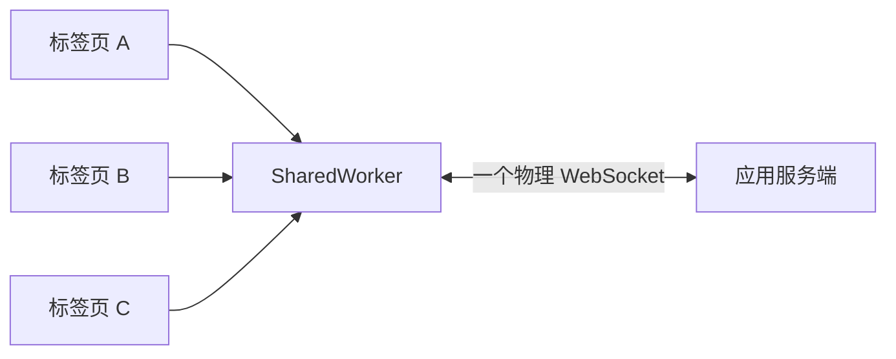

# SocketFuse

[](https://www.npmjs.com/package/socketfuse)
[](packages/socketfuse/LICENSE)

[English](README.md) · **简体中文**

以 SharedWorker 为首选，让同源浏览器标签页共享 WebSocket 连接。

SocketFuse 面向需要在多个标签页接收实时数据的应用，例如通知、行情和协作工具。同一 SharedWorker 中，使用相同 `id` 和共享配置的 client 复用一个物理连接，每个页面保留自己的业务回调与生命周期。框架无关，提供 TypeScript 类型，没有第三方运行时依赖。

**项目处于 beta 阶段，升级可能包含破坏性变更。** 安装版本以 npm 的 `beta` 标签为准，升级前请阅读 [CHANGELOG](packages/socketfuse/CHANGELOG.md)。仓库文档随 main 更新；中文文档是维护基准，英文 README 与其同步。

## 主要能力

- **多标签页共享**：共享 socket、心跳、发送队列和重连预算，配置冲突显式报错。
- **默认内联 Worker**：无需单独部署 Worker；也可使用静态同源 Worker 配合 CSP 和自定义协议。
- **连接级协议处理**：在 Worker 中定义收到标志、控制帧过滤和业务投影，每个物理帧处理一次。
- **有界资源**：发送队列、端口投递、待决操作和生命周期回放都有容量限制。
- **页面分派**：普通回调在各页执行；`dispatchKey` 为同一帧选择一个接收者。
- **明确的降级策略**：内联 Worker 初始化失败可降级到页面内 direct；选定 transport 后不会因网络故障切换。

## 安装

```sh
pnpm add socketfuse@beta
```

也可使用 `npm install socketfuse@beta` 或 `yarn add socketfuse@beta`。

## 快速开始

在浏览器页面中创建 client。以下示例使用 JSON 协议，并显式控制首次连接：

```ts
import { createWebSocket } from 'socketfuse'

const ws = createWebSocket('wss://api.example.com/events', {
  id: 'events:user-42',
  protocol: { type: 'json' },
  immediate: false,
  onError: (_client, error) => console.error(error.code),
})

const unsubscribe = ws.onMessage((event) => {
  console.log(event.data, { replayed: event.replayed })
})

await ws.open()
const receipt = await ws.sendMessage({ type: 'subscribe', channel: 'notifications' })
console.log(receipt.status) // accepted 或 queued

// 页面不再使用此 client 时释放注册和资源。
unsubscribe()
await ws.dispose()
```

将示例 URL 换成你的 WebSocket 服务地址。在另一个同源标签页使用相同 `id`、共享配置和 Worker 部署，即可加入已有连接。示例中的订阅消息由你的服务端协议定义。

省略 `protocol` 时使用 raw 模式，只接受字符串、Blob、ArrayBuffer 或类型化数组视图。`immediate` 默认是 `true`；设为 `false` 可以先注册回调和重连 hook，再调用 `open()`。`close()` 只退出本页参与，之后仍可 `open()`；`dispose()` 永久释放 client。

`sendMessage()` 成功仅表示本地接纳或入队，不证明服务端收到。发送确认丢失时可能报 `SEND_OUTCOME_UNKNOWN`，应用不能据此认定消息未发送。

## 共享与协议边界



共享范围是同一个 SharedWorker 实例，包括 origin、Worker URL、名称和浏览器分区。`id` 是复用标识，不是授权凭据。相同 `id` 的协议、重连和资源配置不一致会报 `CONNECTION_CONFIG_CONFLICT`。

初始 URL 不属于共享身份。后来页面传入的 URL 不覆盖现有连接；需要更新 endpoint 时使用重连准备 hook。认证、业务就绪、游标和幂等由应用协议维护。

| 能力 | 契约 |
| --- | --- |
| 重连 | 页面、Worker 和自动恢复共用 `reconnect.maxRetries`；`countAsRetry: false` 只豁免本次，不清零预算。 |
| Worker 扩展 | 同步 `onFrame` 可消费、回复、投影和请求重连；Worker 不等待页面业务回调。 |
| `dispatchKey` | 每帧、每个 key 至多选择一个接收者；不保证跨页异步副作用互斥，也不执行回放。 |
| 回放 | 按页启用、有界、仅保留内存中的业务投影；Worker 重启后不能恢复历史消息。 |
| direct | 共用相同 runtime 和资源限制，共享范围仅限当前页面 realm。 |
| 自定义 Worker | 初始化失败显式报错，禁止降级到 direct 后丢失协议逻辑。 |

## 浏览器与部署

三个公开入口可在 SSR/Node 中安全导入；实际创建 client 必须在浏览器页面中进行。SharedWorker 支持情况、页面冻结和存储分区取决于浏览器，CI 使用 Chromium、Firefox 和 WebKit 验证。

默认内联 Worker 使用 `data:` URL。CSP 禁止该来源时，请部署静态同源 Worker，并确认 WebSocket 服务端的 Origin 与认证策略。详见[降级与 Worker](packages/docs/site/guide/fallback-and-worker.md)和[兼容性与安全](packages/docs/site/reference/compatibility-and-security.md)。

## 文档

产品指南和 API 注释以中文维护。文档站可通过贡献指南中的步骤在本地启动。

| 入口 | 内容 |
| --- | --- |
| [快速开始](packages/docs/site/guide/getting-started.md) | 安装、连接、发送和清理 |
| [连接共享](packages/docs/site/guide/connection-sharing.md) | 共享身份、配置冲突和页面分派 |
| [可靠性](packages/docs/site/guide/reliability.md) | 重连预算、队列、背压与心跳 |
| [Worker 共享处理](packages/docs/site/guide/worker-extensions.md) | 自定义收到标志、协议投影和连接准备 |
| [生命周期与回放](packages/docs/site/guide/lifecycle-and-replay.md) | 页面暂停、恢复和消息边界 |
| [配置参考](packages/docs/site/reference/configuration.md) | 配置作用域、默认值和资源上限 |
| [API 参考](packages/docs/site/api/index.md) | 构建文档站后查看三个公开入口的完整类型 |

公开入口固定为 `socketfuse`、`socketfuse/protocol` 和 `socketfuse/worker`。应用不应导入内部 workspace。

## 参与贡献

欢迎提交带最小复现的问题、文档改进和有明确使用场景的功能建议。开发环境、验证命令与 PR 要求见 [CONTRIBUTING.md](CONTRIBUTING.md)，实现约定见 [AGENTS.md](AGENTS.md)。

[报告问题](https://github.com/wh1teAlter/socketfuse/issues) · [查看变更记录](packages/socketfuse/CHANGELOG.md)

## 许可证

[MIT](packages/socketfuse/LICENSE)
