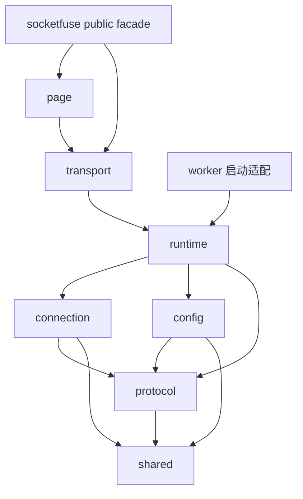

# SocketFuse 运行时正确性重设计

本方案覆盖[审查报告 3](../review/3.md)的 F01–F22，以及报告中的职责、文档和未结算异步工作问题。新增需求的详细契约见[Worker 协议处理与统一重连预算](worker-protocol-and-reconnect-budget.md)，本文已同步修订对应规则。用户已允许破坏性变更、重构和设计调整；本文选择一个明确的目标设计，不保留多套兼容实现。本文是已批准的实现规格；任务进度与验证证据记录在 `.scratch/runtime-correctness/`。

## 1. 总体决策

推荐保留 SharedWorker-first 和三个公开入口，围绕五个决定重构：

1. **一套连接 runtime，两种接入位置。** shared 使用 Worker 端口，direct 使用页面内原生 MessageChannel；两者共用连接池、参与期、控制协议、回放、额度与错误出口。
2. **明确每种生命周期的所有者。** client 实例、页面参与期、共享连接条目、物理尝试、重连计划分别拥有自己的状态；关闭端口不等于销毁 client，重置退避不等于重置物理尝试编号。
3. **协议转换同步化。** 删除异步 adapter 队尾；原生入站固定 ArrayBuffer，异步外部 I/O 只留在有明确期限和并发额度的准备 hook。
4. **key 改为单接收者分派。** runtime 决定每帧的分派资格，页面拒绝过期资格；公开 API 不再声称能强制保证跨页互斥执行。
5. **先接纳计费，再进入处理链。** 页面待决操作、端口克隆、原生发送队列和入站回放分别有明确预算；所有公开错误使用同一安全表示。

对应的长期决策记录为 [ADR 0006](../adr/0006-one-runtime-for-shared-and-direct.md)、[ADR 0007](../adr/0007-synchronous-protocol-transformations.md)、[ADR 0008](../adr/0008-single-recipient-dispatch.md)、[ADR 0009](../adr/0009-worker-protocol-actions-and-retry-budget.md)。

现有复用不足之处很具体：ConnectionController 已复用，但其上层仍存在两套池回收、回放、等待和错误传播。仅抽取一个 replay helper 或继续补布尔状态，无法消除这些分歧。新增 runtime 目录是迁移已有连接所有权代码，不引入通用事件总线、插件框架或 RPC。应用可以通过 Worker 扩展自定义收到确认等协议回复，库不内置通用 Ack 或请求关联服务。

## 2. 模块职责与依赖

以下箭头表示“依赖”，所有运行时值依赖必须沿箭头流动：

| 模块 | 目标职责 | 迁移或删除 |
| --- | --- | --- |
| shared | 基础类型、安全错误表示、字节计费、不可变配置的基础校验。 | 删除通用 public details/cause；保留独立于连接生命周期的工具。 |
| config | 页面默认值与本地选项、共享配置语义校验、canonical。 | 页面和控制 parser 共用同一组字段约束，不维护两份数值合法性。 |
| protocol | 同步 raw/JSON/custom 编码、解码、分类和心跳帧生成。 | 删除 OrderedProtocol、adapter 的 MaybePromise 返回值。 |
| connection | 单一物理连接状态机、尝试代际、出站队列、心跳、统一重连预算与计划。 | 将 transport/socket.ts 移到 connection/socket.ts；删除 outgoingTail 和逐 client 的 sink/attach 管理。 |
| runtime | 共享连接池、参与期、分派接收者、回放与 delivery credit、连接扩展及其效果、准备事务、控制协议。 | 从 worker/runtime、worker/control、worker/exclusive-keys、transport/reconnect-coordinator 迁入现有职责。 |
| transport | 原生端口客户端、短控制请求、通道健康与端口创建。 | 一个 PortTransport；direct 不再单独调用 controller 或页面 sink。 |
| worker | 创建 Worker realm 的 runtime、静态注册协议/扩展、接入 onconnect。 | 保留公开 worker 入口的薄适配，不拥有另一套运行逻辑。 |
| page | 稳定 WebSocketClient、本地 waiter、handler、页面生命周期、公开状态缓存。 | 删除页面 replay 队列；不拥有连接池、不自行仲裁 key。 |
| facade | 浏览器 realm 校验、公开选项校验、惰性创建与一次 transport 选择。 | immediate:false 不创建端口、不占共享 id。 |

runtime 内先使用 `host.ts`、`control.ts`、`delivery.ts`、`dispatch-owners.ts`、`preparation.ts` 和迁入的 reconnect coordinator。每个文件对应现有的独立职责；不为了目录对称拆空模块或包装每个方法。小的状态记录可以留在所属文件，不要求每个记录都变成类。

ConnectionController 只向所属 runtime 条目输出一个内部 observer，不再向多个页面 sink 广播。参与者数量、idleGrace timer、扩展调用与 fan-out 均由 runtime 拥有；controller 只接收是否仍有连接需求。出站项保留不透明 owner 标记供取消尚未发送的项，controller 不据此维护页面对象或候选身份。创建条目时先建立尚未启动 socket 的 controller，再创建扩展，最后提交 attach 和连接需求；扩展工厂失败完整回滚 attach，不带着缺失的扩展开始连接。

direct 的 runtime 在当前页面、当前库实例内惰性共享。不同标签页的 direct runtime 互相独立；同一页面的多个 direct client 则像 shared 一样按 id/config 复用连接、仲裁分派 key。不会使用 globalThis 注册表跨不同包副本隐式共享。

MessageChannel 是有意选择：它提供与 shared 相同的异步交付和结构化克隆，隔开 controller 与用户 handler 的同步调用栈。direct 的页面长任务仍会阻塞所在 realm，这个性能差异必须保留在文档中，不能声称获得 Worker 的调度隔离。MessageChannel 不可用时明确失败，不再引入第三条同步路径。

共用 runtime 的源码不等于两个 realm 共享一份执行内存：内联 Worker 与 direct 后备代码可能增加页面包体积，实施时必须报告真实 gzip 和启动成本。不能为维持旧数字恢复第二套语义；任何体积验收阈值调整都说明实际增量及理由。

实现该结构时同步修改 AGENTS 的依赖图，以及各模块 README；模块 README 以实际已实现职责为准。

## 3. 生命周期模型

| 概念 | 所有者与身份 | 结束条件 |
| --- | --- | --- |
| client 实例 | page；稳定实例和本地注册意图。 | dispose，永久终态。 |
| 参与期 | page 与 runtime 的一次端口关系；独立 sessionId。 | close、dispose、通道失效或 lease 回收。结束后不可复活。 |
| 共享连接条目 | runtime；connectionEpoch + id + canonical。 | 最后一个参与者离开后的 idle 回收，或 runtime dispose。 |
| 物理尝试 | connection；connectionEpoch 内单调 attempt。 | socket 终止、替代、超时或关闭。 |
| 重连计划 | connection；当前唯一 planId、计数策略和准备期限，覆盖一次替代过程。 | 新尝试 open、失败或计划取消；准备事务可提前一次性提交并结束。 |
| 重连预算 | connection；当前条目内的 retriesUsed 和至多一个预留。 | 连续稳定 open 重置（可禁用），或条目释放。显式请求不重置。 |
| 分派资格 | runtime；sessionId + connectionEpoch + grantGeneration。 | 接收者变化、参与期结束或权威验证失效。 |

### 3.1 transport 选择只提交一次

选择状态只有 `unselected → shared` 或 `unselected → direct`。选定后不再回到 unselected；close 只结束参与期。Worker 实例身份和 transport 选择状态不能共用同一个可清空字段。

初始化分为握手与 attach：握手只确认协议版本、部署能力和资源限制，不创建连接条目或 socket；成功 welcome 后锁定 shared。attach 再校验共享配置、创建参与期并提交连接需求。共享配置冲突、attach 失败、socket 错误和后续恢复失败均不触发 fallback。失败握手使用独立候选代际，迟到 welcome 不能覆盖已选 direct。

内联 raw/JSON 模式在明确的 API 缺失、Worker 构造、加载或初始化失败上允许 direct。配置了 custom Worker 时 fallback 固定为 error；显式填写 direct 在创建边界拒绝。不能根据 custom Worker 是否碰巧声明扩展来猜测降级是否安全。

### 3.2 close、reopen 与恢复

close 立即停止页面业务派发、撤销本地分派资格并拒绝本参与期 waiter，再发送 detach。允许短控制期限内确认远端 detach；无论确认成功或失败，最终都销毁该端口及监听器。确认失败仍向调用方 reject，远端残留参与者由 lease 有界回收。

再次 open 永远建立新端口和 sessionId。BFCache/Worker 恢复也调用这一条重建路径；新参与期重新注册 handler 意图和 hook，不复用旧授权、旧请求或旧 reply。

页面只保存当前 desired state 和至多一个正在执行的 attach/close 过渡，不用 Promise tail 排队任意数量的生命周期调用。close 期间发生的 open 等待该过渡结束后按最新意图创建新参与期；随后的 close 可以取消这个意图。dispose 优先成为终态。所有异步完成先检查参与期代际，旧 close 的 finally 不能清理新端口。

### 3.3 连接池按参与期回收

构造 client 不占池；attach 才取得条目。最后一个参与者离开后，条目先经历 idleGraceMs；宽限期内重新 attach 保留原 endpoint，宽限期后关闭原 socket 并结束其尝试，再删除条目。只有完成回收后的新创建者才能提供新的初始 URL。

关闭过程中不能创建第二个同 id socket；新需求只记录在原条目上，等待原 socket 确认终止后推进。条目回收与新 attach 的判断在 runtime 中串行完成。共享配置仍显式比较 canonical，不通过 URL 或短 hash 推断身份。

shared/direct 使用同一条规则。旧 client 实例不保存 controller 引用，所以不存在删除池条目后旧实例继续访问已 dispose controller 的问题。

## 4. 分派 key 的可兑现契约

### 4.1 为什么调整公开设计

在可无限停顿的页面与可转移的 lease 之间，不能同时承诺旧页面被强制停掉和新页面及时接管。补 revoke、页面 timer 或本地 TTL 都无法撤回已经 post 的帧；检查时钟也不是跨页面副作用的原子执行锁。

目标保证是：**同一 runtime 连接实例中，每条原生入站业务帧、每个 dispatch key，至多选择一个参与期接收该 key 的实时分派资格。** 它不保证服务端重发去重、不保证至少一次投递，也不保证不同帧的页面异步副作用互斥。

### 4.2 资格随投递记录，不能从当前 held set 推导历史资格

普通业务帧仍送给全部参与者。runtime 在 fan-out 时附带该参与期此次可执行的 dispatch key 及 grantGeneration；无资格的页面只执行普通 handler。资格元数据与 payload 一起计入 envelope 和 delivery credit，受 key 总数与单帧限制。

grant/revoke 继续用于观察当前接收者和取消 signal；但当前 isDispatchOwner 为 true，不能让页面补执行过去未选中它的帧。接收者交接不重新发送旧帧，不增加业务消息 ID 或 dedupe 状态。

启动 keyed handler 前同时检查当前参与期、connectionEpoch、grantGeneration、权威有效期及 signal。close/freeze/撤销立即使其失效；旧 signal 先 abort，再考虑后续新 grant。runtime 的撤销先修改内部状态，再尽力通知旧端口，投递失败的 cleanup 不可递归破坏新接收者。

### 4.3 lease 确认与迟到投递

lease 从单向报活改为带序号的 ping/pong，复用通道健康检测。页面记录发送时刻，以发送时刻而非收到响应时刻计算保守的本地有效期；迟到 pong 不能凭到达时间延长旧资格。返回的 session、连接和 grant 代际必须全部匹配。

页面在派发入口按时间重新校验，而不依赖 timer 已经执行；长任务结束后排在 timer 前面的旧消息也会经过检查。明确生命周期恢复、时钟异常或无法确认时间连续性时先关闭资格，再 probe/重新加入。Worker 按自己的 lease 记录决定接收者转移，不信任页面声明自己仍为 owner。

跨 realm 的时钟和调度不能当作严格同步的事实，因此上述检查是过期抑制措施，不把新契约重新扩大为分布式互斥。需要严格副作用一致性的应用应使用其服务端条件写入、幂等事务或适用的平台锁；SocketFuse 不在内部实现这些系统。

### 4.4 replay 不重跑 keyed 副作用

replay 只派发给普通 onMessage handler 和 message EventTarget listener。带 dispatchKey 的 handler 只处理获选的实时帧。这样恢复逻辑不会把旧连接、旧 owner 或暂停期的缓存突然变成新副作用；需要回放更新本地视图时注册普通 handler。

公开 API 破坏性更名为 `onMessage(handler, { dispatchKey })`、`isDispatchOwner(key)` 和 `dispatchownerchange`；删除旧 key 选项、holdsKey 和 keychange 的兼容别名。文档同时明确 isDispatchOwner 是经本地验证的最近状态，不能单独拿它包围任意业务代码并获得互斥保证。

## 5. 同步协议与物理尝试隔离

encode、decode、classify、createPing、createPong 和 shouldReconnect 均同步返回。运行时拒绝 Promise/thenable，报告稳定的协议契约错误，并安全处理意外返回 Promise 的 rejection；不 await、不建立隐式队列。异步返回属于终止当前连接的 adapter 契约违例，不自动重试同一无效 adapter，避免每帧继续启动新的违规异步工作。普通同步编码/解码异常仍按第 9 节处理。

原生 WebSocket 的 binaryType 固定为 arraybuffer；adapter.decode 输入为 string 或 ArrayBuffer，raw 二进制 heartbeat 直接同步比较字节。对 raw client，公开 binaryType 变为页面本地的输出表示选项：选择 blob 时在真正派发前同步创建 Blob。它从共享 fingerprint 中移除；JSON/custom 的业务数据表示完全由 adapter 决定，拒绝无意义的 binaryType 组合。出站仍接受 Blob、ArrayBuffer 和视图。

因此删除 OrderedProtocol 和 outgoingTail；每次 socket message 或端口 send 都在单次任务中完成协议转换和接纳决定。异步加解密、解压或业务查询由应用先完成，再 send；入站需要异步处理时消费 raw 帧。代价是 custom adapter 的破坏性迁移，收益是没有永不完成的旧 decode 阻塞新尝试。

同步化不取代代际守卫。每个物理尝试持有 socket、attempt、监听清理和 timer；socket 回调、用户提供的同步 adapter/扩展回调返回后、心跳 timer、排队 flush 继续前都重新核对当前尝试。同步 callback 也可能在 direct realm 中触发重入，所以状态提交必须先完成，外部通知随后执行。

物理尝试从发起原生构造时递增，即使构造失败也计数。结束尝试统一清理全部监听和 timer；不会在多个 catch 分支各自维护一份不完整 cleanup。

分类增加应用 `control` 帧；data/control 由连接扩展的同步 onFrame 在 fan-out 前处理一次，取代 filterInbound。它返回有界协议回复、consume/业务投影及可选重连请求，不暴露原始 socket。标准 ping/pong 仍由唯一心跳引擎消费；有跨帧状态需求时由扩展的一组同步 createPing/createPong 提供该连接的心跳生成来源，不与 adapter 生成器叠加。详细的来源选择和错误策略见[补充规格](worker-protocol-and-reconnect-budget.md)。

## 6. 出站 FIFO、背压与内存所有权

### 6.1 唯一发送推进函数

ConnectionController 使用一个发送推进函数处理实时发送和队列冲刷：

1. 同步编码并检查 wire 大小；失败不接纳。
2. 若已有队列，当前发送不得越过队首。允许排队则追加，否则拒绝为背压/顺序阻塞。
3. 队列为空且 socket open、低于高水位时尝试原生 send；正常返回才返回 accepted。
4. 断线或高水位时，只有允许排队且预算足够才返回 queued。
5. 有积压且 socket open 时维护唯一 flush timer；每次成功发送一项后重新检查 bufferedAmount，高水位停止并等待低水位恢复。
6. open、背压入队和 flush timer 都只唤醒同一推进函数；队列清空、尝试结束、close/dispose 时取消 timer。

正常运行不得在背压解除后遗漏唤醒。队列所有者离开时移除其尚未发送项；移除队首后如连接可发送，应再次推进。原生 send 抛错时，本项不能被标记 accepted 或从队列消费，并进入当前尝试统一的错误/恢复处理。

bufferedAmount 的高水位是流控阈值，不是能精确限制浏览器内部内存的硬上限；最后一帧可使其越过阈值。单帧 wire 上限约束这次增量，下一帧必须等恢复。

上述 FIFO 约束页面业务发送。心跳与扩展协议回复使用同一个当前尝试控制发送能力，允许插入业务发送之间，但同样检查编码、单帧和水位；无法立即发送就明确失败，不进入断线队列，也不带到下一次尝试。

### 6.2 分清 wire 字节与保留字节

wireBytes 只描述原生 WebSocket 发出的有效字节。retained/cloneBytes 描述库保留或结构化克隆的表示预算，必须包含视图的完整 backing buffer。不能再用同一个函数混用两种单位。

图遍历对 backing ArrayBuffer 去重：多个 view 引用同一 buffer，在同一 envelope 中计 buffer 一次，另计各 view 的元数据；在不同 envelope 中分别计费。覆盖 DataView、循环引用、Map/Set、重复引用、深度/节点数限制及无法读取的 buffer。拒绝 SharedArrayBuffer 与无法安全估算的表示；访问器字段和 Proxy 等不能安全完成预算检查的输入显式拒绝。

跨端口前做预检查，接收端对实际收到的 clone 再校验。前者防止本库为明显超额输入执行克隆，后者保护 runtime 的存储额度；恶意同源代码直接 post 的分配已发生在接收校验之前，不能承诺阻止浏览器的首次分配。估算预算也不等于 JavaScript 引擎的精确堆大小。

出站队列仅保存已编码且由库拥有的紧凑值：视图复制有效区间，ArrayBuffer 复制，字符串和不可变 Blob 可直接保留。这样 queue.maxBytes 的 wire 预算不会被 1 字节视图保留巨大 backing buffer 绕过，调用方修改原始二进制也不能改变已经 queued 的消息。

### 6.3 额度覆盖页面与端口之前

保留现有连接队列、Worker 端口、control envelope 与 delivery/replay 上限，并在统一 PortTransport/page 增加统一的用户操作预算：每参与期最多 64 个待决用户操作（包含本地 open waiter）、累计最多 4 MiB 待决操作预算；这些是内部静态上限，写入兼容性/资源文档。发送前检查，额度不足立即拒绝，不排队等待额度。

用户额度耗尽不能阻断 cleanup 和 credit 归还。hello/attach/detach 使用至多一个生命周期过渡，lease/probe 至多一个待决确认；receipt 不进入等待表，其未处理数量受尚未归还的 delivery 额度限制。重复状态/诊断刷新只合并最新意图，不形成额外控制队列。维护消息不借用用户发送额度，也不因此获得无界发送资格。

控制 envelope 上限与 maxEncodedMessageBytes 分别限制编码前跨端口值和编码后 wire 值，两者均生效；welcome 提供 runtime 的实际静态限制，客户端不能假定 custom Worker 一定采用默认值。pending 表只保留 requestId、结算函数和计费信息，不在 post 后继续持有业务 payload。

已经有 open 意图、但 attach 尚未完成时，send 可以留在同一有界 pending 表中等待：先计费并取得不可被调用方修改的输入快照，attach 成功后按调用顺序 post，随后立即释放页面保存的 payload。它尚未被 runtime 接纳，所以不能提前返回 queued。此时没有单独的 Promise tail 或无限等待队列；close/初始化失败会拒绝尚未 post 的发送，结果明确为未接纳。没有 open 意图时 send 直接 reject，queue 选项不隐式创建参与期。

direct 使用真实 MessageChannel，因此具备相同的复制、输入限制和 delivery credit。删除此前“只有 shared 有单帧/credit 限制”的例外，不用新增分支模拟 direct 的旧行为。

## 7. 操作完成与取消

### 7.1 open 的 waiter 只属于页面

端口的 open/demand 命令立即确认“已接纳参与意图”，不在 runtime 中挂一个等待 socket 的控制请求。socket 状态通过有序事件和带版本的当前快照发布；page 在发出需求前注册 waiter，并用事件或快照完成它，避免 open 事件先于控制回复到达时丢失唤醒。

AbortSignal 只移除对应 waiter、监听器和期限，不撤销 client 已表达的连接需求，也不取消其他 waiter。调用前已 aborted 则在创建参与期前 reject；开始后的 abort 不等于 close。每参与期本地 open waiter 也计入 64 个操作上限，不能绕过 pending 额度。

connectionTimeout 只限制一次原生建连；hookTimeout 和退避分别属于计划准备与等待。open 等当前需求对应的尝试成功或第一次尝试失败；失败时以真实安全错误 reject，后台自动重试可继续，因为 client 仍有连接需求。后续 open 可以等待新尝试。

### 7.2 控制期限与发送结果未知

hello、attach、register、detach、send 接纳决定等短控制交互使用有界通道响应期限；它不表示 socket 建连超时。目标内置期限为 5 秒，custom Worker 同样遵循控制协议的短操作要求。通道 lease/probe 独立判断可达性；超时不改变已经选定的 transport。

send 命令已经成功 post 后，回复丢失或端口断开时无法证明 runtime 是否已执行原生 send/入队。此时 reject 使用新的稳定码 `SEND_OUTCOME_UNKNOWN`，不能伪装成确认未发送，也不自动重新提交。明确的编码/大小/队列拒绝仍表示未被接纳。成功 receipt 只证明本地 accepted/queued；之后队列回收、网络失败仍可能丢失消息。

### 7.3 所有 Promise API 的失败通道一致

open、close、sendMessage、reconnect、dispose 都保证返回 Promise；参数或生命周期失败在函数的异步边界内转为 rejection。close/dispose 保持幂等，dispose 后 onMessage 等同步注册 API 仍可同步抛出。createWebSocket 只同步校验配置和页面 realm；实际 Worker 创建/初始化失败通过 open 或 immediate 的 error 事件报告。

## 8. 有所有者的重连准备事务

plan 由 connection 在检查重连预算后创建并提供取消信号；runtime 中的准备事务属于当前 ConnectionEntry，包含 planId、总 deadline、草案、AbortController、timer 与一次性结算状态。Worker 扩展和页面候选复用相同的计划提交规则，仍只选一个准备来源。计划的 source、countAsRetry 和预算快照只读，准备方只提交 URL/delay。

所有结束路径遵循同一顺序：先确认并结束当前事务、移除 active 引用、清 timer、禁止 setter，再 abort signal、释放草案/监听并通知上层。这样 AbortSignal 的业务监听器即使同步调用 reconnect，也不会被旧事务的后续 cleanup 覆盖。提交前另外检查当前 planId 和绝对 deadline；timer 尚未执行不能使过期计划成功。

close 导致需求撤销、idle、dispose、计划取消、准备到期或候选失活都会走相应事务的取消路径。重复 reconnect 按同一计划合并，不重启准备期限或取消现有准备；计数策略冲突明确拒绝。准备到期仍可按现有规则提交默认计划，候选失活可在剩余总期限内换下一来源，均不额外创建预算消费。旧 Promise 完成/失败只结算其自身资源，既不提交 endpoint，也不向新尝试广播错误。成功提交一次性修改 URL/delay，所有输入校验在修改状态之前完成。

AbortSignal 不能强制终止不合作的 Promise。为防止连续取消无限启动新任务，每个准备来源最多一个未结算调用，每个 realm 最多 16 个未结算准备调用；不建立等待队列。被取消但未 settle 的调用继续占额度，直到真实 settle。新计划遇到忙的 Worker 扩展时立即采用默认计划并报告安全的 PREPARATION_BUSY；不改用页面 hook。忙的页面候选拒绝本次准备，协调器可在同一总 deadline 内选择下一候选。

dispose 释放库拥有的 timer、草案与连接引用；仍在运行的应用 I/O 不被称为已强制终止。未结算额度的结算回调只保留最小记录，不能继续持有整条连接或 payload。prepareAttempt 指南示例必须把 signal 传给支持取消的 fetch 等业务 I/O。

## 9. 错误、callback 与诊断

删除公开 SocketFuseError 的任意 details/cause。公开错误只包含稳定 code、由库生成的安全 message、fatal/retryable；Worker 与 direct 的序列化完全相同。必要的队列数量、字节、丢弃数通过已有结构化指标/overflow 事件表达，不塞回自由字段。

任何来自 adapter、扩展、页面 hook 的 throw 都是不受信输入。即使它 instanceof SocketFuseError，也按当前调用阶段重新创建库错误，不保留原 message、code 伪装、details 或 cause。未知端口错误也走同一个映射。

所有外部 callback 都经不抛出的调用边界：一个 handler/onConnected/onDisconnected/onError/logger 失败不能影响其他消费者或状态推进。logger 和 onError 自身失败直接隔离，不递归报告给自己；其意外返回的 rejected Promise 同样处理。shouldReconnect 抛错时报告安全协议错误并采用默认重连许可，仍受重试预算约束，不允许中途退出 close cleanup。

协议同步回调的错误策略固定：encode 失败拒绝本次发送；decode/classify 失败丢弃当前帧并报告安全错误；createPing/createPong 失败报告错误并由当前尝试的心跳/恢复规则推进。onFrame 抛错或返回无效结果时消费当前帧、无效果并报告错误，不把原始协议控制数据放行到页面；意外异步返回属于终止性的同步契约违例。效果开始执行后的局部失败不撤销已被原生 send 接纳的回复或已投影的业务消息，后续效果仍须核对 attempt。所有策略均在运行时文档中明示。

diagnostics 与扩展上下文从当前 controller 的同一安全快照生成，不捕获初始 config.url。只暴露当前 origin，不带 path/query。page 的 diagnostics 在两条 transport 中都返回最近缓存样本，新增 observedAt 表示页面收到该样本的时间；调用可触发至多一个合并的后台刷新，不承诺同步读到 runtime 的当前值。

状态快照增加 connectionEpoch；attempt 只在此 epoch 内单调，retriesUsed 独立表示当前预算周期已启动的计数重连次数，另提供 retriesRemaining 和 retryReserved。跨条目回收或 Worker 重建不能比较 attempt 数字大小，必须先比较 epoch 是否相同。

## 10. 退避、配置与 endpoint

重试预算属于共享连接，覆盖首次尝试之后所有计数重连。自动恢复始终计数；页面 reconnect 和 Worker onFrame 的重连请求默认计数，可显式 countAsRetry:false。所有入口共用一个计划与预算；显式请求及不计数请求均不清零。接纳时先预留额度再替代健康连接，实际启动 socket 时才扣数，启动前取消释放预留。重复请求合并同一计划；冲突策略或过期尝试请求拒绝，不能反复重启新 socket。

配置统一为 reconnect 对象，automatic 开关与 maxRetries 独立。预算耗尽时拒绝计数请求，保持仍健康的连接；显式不计数仍可发起，但失败后的自动恢复使用原来剩余额度。计数计划按 retriesUsed + 1 计算默认退避，第一次使用 initialDelay；不计数默认延迟为零，准备方也可单独设置延迟而不更改预算。完整 API、并发规则和三次预算示例见[补充规格](worker-protocol-and-reconnect-budget.md)。

稳定窗口仅属于当前 open 的物理尝试。onOpen 开始窗口；到期 timer 必须核对当前 attempt 和 open 状态；close 路径先按实际连续 open 时长结算，再清 openedAt 和 timer。接纳重连请求也先结算已达到的窗口，再检查预算；计划接纳后封存窗口，等待关闭、准备和退避不继续累计。被拒绝的请求不取消健康 socket 的稳定窗口。未成功 open 的尝试绝不能借用上一次 openedAt 重置预算。stableThreshold:false 禁用稳定重置；除连续稳定 open 或新 connectionEpoch 外，不重置预算。

退避结果在 jitter 之后再限制到 `[0, maxDelay]` 并取整；maxDelay 是最终实际等待上限。避免先对指数基准截断后又超上限，默认上限保持 30000 毫秒。

所有毫秒配置采用有限安全整数，并限制在平台 timer 可正确表达的范围内，最高 2147483647；connectionTimeout/hookTimeout/lease 为正数，允许零的字段按语义单独声明，lease.timeout 必须大于 interval。1000.5 在页面创建边界即 INVALID_OPTIONS。defaults 只由页面规范化应用；Worker 对完整 wire 配置严格校验，不默默补齐缺失字段。两者调用同一组语义 validator。

URL 的初始值、页面 setter、扩展 setter 和 Worker 重建共用一个规范化函数：固定绝对 ws/wss 字符串、长度限制、拒绝 fragment（包括空的 `#`）与 userinfo。完整 URL 不参与 canonical，也不被错误回显。浏览器仍可能因受限端口/CSP 等原生规则拒绝构造，这归属于建连失败，不能引发已选 shared 的降级。

## 11. 唯一回放缓冲与页面派发

replay 只存在于 runtime 的参与者投递状态中。暂停时按该参与者的 maxMessages/maxBytes 缓存，先检查新帧能否单独容纳，再按 oldest-first 淘汰；单条超大帧只增加自身 overflow，不影响旧缓存。

restore 时先排空旧 replay，再恢复实时投递顺序；若 delivery credit 不足，保留待回放队首，在 receipt 归还 credit 后继续。回放期间新帧接在同一个有界缓冲尾部，不能越过旧项。缓冲满仍按已定义 overflow 策略处理，不增加无限中转队列。

页面统一经过一个 dispatchMessage 入口：验证参与期/消息表示 → 更新 data → 调用符合条件的 handler → 派发 EventTarget message。暂停收到但尚未派发的消息不更新 data；每条 replay 都在 handler 前更新对应 data。raw Blob 表示转换也发生在此入口。

receipt 仍在业务 handler 之前归还，表示传输层已经取走消息，不等待 Promise 业务处理成功。取消参与期清空其 replay 和 outstanding credit；旧 receipt 只能影响旧 sessionId，不得释放新参与期的额度。页面业务 handler 的异步任务并发与副作用由应用控制，delivery credit 不被描述为这类业务任务的并发上限。

## 12. 发布包验收与文档

把 release:verify 做成从干净 checkout 可独立运行的命令：由现有 tarball verifier 执行一次 pnpm pack，利用 prepack 构建发布所需依赖闭包，再对解出的实际 tarball 执行 publint、文件白名单、类型、source map、Vite 与 SSR 验收。删除“先对源码目录 publint，再运行会 build 的 pack”的顺序。

publint 使用解包目录和 pack:false，不触发第二次打包；将它的开发依赖和调用统一归属 packages/test 的发布验收模块，不提升到根目录。prepack 不调用 release:verify，避免递归。无需为了发包构建 docs。

Version PR 和业务 PR 都使用同一验收入口；增加不含 dist 的隔离 checkout 测试。受保护发布 job 在已验证的版本提交上生成并验收 tarball，随后发布这个已经验收的文件，不在 publish 时重新构建另一个产物。artifact 必须来自该 job/commit 的新目录，校验唯一文件、包名、版本及摘要。

现有 GitHub App 身份、标题、专用分支、文件白名单、npm environment 与 OIDC 约束全部保持；不提供本地发布或长期 npm token 路径。每个面向用户的实现批次带 Changeset；本轮设计文档不改版本或 CHANGELOG。

README 删除硬编码“正在准备 0.0.1-beta.1 首发”和“首次发布后才能安装”的当前状态描述；版本状态指向 releases/npm，示例按当前受支持 API 编写。扩展指南统一使用尽力而为语义，删除 at-least-once；去重示例注明应用自有状态的容量/寿命和丢失边界。旧迁移规格中的一次性本地发布步骤明确标作历史步骤，不再作为现行发布操作指南。

## 13. F01–F22 的实现与验收映射

| 问题 | 最终方案 | 必须加入的回归场景 |
| --- | --- | --- |
| F01 过期 key 启动 | 单接收者分派 + 每帧资格 + session/grant 校验 + lease pong；移除强互斥承诺。 | visible 页面停顿后处理旧队列被过期检查拒绝；迟到 grant/pong 不恢复旧资格；同一帧/key 只选一参与期。 |
| F02 reopen 降级 | transport 选择永久锁定；close 后新建端口与参与期。 | 超过旧 lease 回收期限再 open，仍为 shared；构造新 Worker 失败明确 reject。 |
| F03 队列滞留/越序 | 唯一发送推进函数和 flush timer；队列非空禁止旁路。 | first queued、排空 buffer 后自动发送；second 不越过 first；逐帧检查水位。 |
| F04 backing buffer 低估 | wire/clone 计费分离；完整 buffer 去重计费；队列持有紧凑副本。 | 1 字节 view + 8 MiB buffer 在克隆入口超限；多 view/循环/DataView 计费；修改原值不改变 queued 帧。 |
| F05 details 泄漏 | 删除任意公开 details/cause；统一阶段错误映射与端口路径。 | adapter 抛含 token、payload、内部文本的 SocketFuseError，shared/direct/logger/onError 均不出现原值。 |
| F06 旧异步尝试污染 | 同步协议删除异步队尾；统一 attempt 守卫与 cleanup。 | 类型和运行时拒绝异步 adapter；旧 socket 回调/timer/重入后的继续分支不得派发或污染新状态。 |
| F07 Version PR 构建顺序 | pack/prepack → 验收同一 tarball。 | 无 dist 的隔离 checkout 单独运行 release:verify 成功；三个入口均在实际 tarball 中。 |
| F08 open abort | 本地独立 waiter，需求与等待分离。 | hello 前、attach 中、socket connecting 中 abort；只有对应 waiter reject，其他 waiter 和连接继续。 |
| F09 固定请求超时 | open 由状态事件完成；短控制期限与建连期限分开；未知 send 结果专用错误。 | connectionTimeout 30 秒、15 秒 open 成功；接纳后丢 reply 返回 SEND_OUTCOME_UNKNOWN 且不重发。 |
| F10 logger 隔离 | 不抛出的外部 callback 边界，错误 sink 不递归。 | first handler 与 logger 同时抛错，second 和 EventTarget 仍执行；无未处理 rejection。 |
| F11 扩展未取消 | plan 所有的准备事务，原子失效、清 timer、abort、禁止 setter；重复请求合并。 | 重复 reconnect 不重启准备；需求撤销或 dispose 使旧 signal aborted、timer 清空、旧 setter 拒绝；晚 settle 不改状态。 |
| F12 错误稳定窗口 | openedAt/timer 只属于当前 open 尝试，结束时清除；全部入口共用预算。 | open 5 秒后断线，下一次一直 connecting 到 40 秒失败，不恢复预算；计数/不计数显式重连不清零。 |
| F13 replay 淘汰顺序 | runtime 唯一缓冲，先判断单帧可容纳。 | maxBytes 10，ok 后跟 11 字节帧，两模式均回放 ok，overflow 只统计大帧。 |
| F14 池回收不一致 | 同一 runtime 池，构造不占用，参与期结束后 idle 回收。 | A close/idle 完整回收、保留 A 实例，B 新 URL 生效；A 再 open 重新 attach；宽限期内仍复用旧条目。 |
| F15 旧 origin | 当前 controller 安全快照是唯一来源。 | host/path 更新后 onSocketOpen/onFrame/diagnostics 使用当前 origin，均无 query。 |
| F16 data 错位 | data 只在真正派发入口更新。 | 暂停时 data 不前进；回放 a 的 handler 读到 a，随后 b 读到 b。 |
| F17 jitter 超上限 | 最终 clamp + 整数毫秒。 | random 0/0.5/1、退避达到上限、极大 attempt 都保持结果有限且不超过 maxDelay。 |
| F18 配置合法集差异 | 统一严格 validator，毫秒为平台范围内整数。 | 页面、Worker、计划 setter 使用同一边界表；1000.5 提前拒绝；缺字段 wire 配置不被补齐。 |
| F19 at-least-once 误导 | 统一为有界尽力而为；不做自动可靠重投。 | 文档示例说明首次丢弃/重复输入/Worker 回收；不把 receipt 解释为业务成功。 |
| F20 attempt 非单调 | connectionEpoch + 单调 attempt；retriesUsed、剩余和预留独立。 | 显式重连及不计数重连均增加 attempt；稳定窗口只重置预算，条目重建 epoch 改变。 |
| F21 Promise 同步 throw | 生命周期校验位于 Promise 边界内。 | dispose 后各 Promise API 都可由 .catch 捕获；close/dispose 幂等；同步注册 API 保持同步。 |
| F22 README 过期 | 去掉易失真的首发版本叙述，链接实际发布状态。 | README/站点安装示例与目标 API 一致，历史规格不被当成现行发布指南。 |

报告中的另外三类候选也有明确处理：异步 adapter 的隐藏积压随同步化删除，准备 hook 的未结算工作单独限额；shouldReconnect 抛错在错误策略中定义；fragment/userinfo 在统一 endpoint validator 中拒绝。它们不被倒写成旧审查已复现的 findings。

## 14. 破坏性变更与迁移

| 旧设计 | 目标设计 |
| --- | --- |
| direct 同步调用及独立池/回放 | MessageChannel + 同一 runtime；direct 也有克隆与 credit 限制。 |
| direct 每 client 自持 execution key | 同一页面共享域内，按相同规则选择一个分派接收者；跨页无保证。 |
| 页面传 ProtocolAdapter 函数 | 页面只传 custom descriptor（type/id/version/sharedConfig），实现只在 custom Worker 静态注册。 |
| custom Worker 默认可 direct fallback | custom Worker 只能 fallback:error，显式错误配置提前拒绝。 |
| adapter 返回 MaybePromise | 协议转换同步；异步业务移到 adapter 外。 |
| 扩展 filterInbound 只返回 deliver/drop | 同步 onFrame 返回协议回复、consume/业务投影与可选重连；协议控制帧在 fan-out 前消费。 |
| 心跳生成只由 adapter 提供 | 默认保留原来源；连接扩展需要状态时提供整组生成 hook，由同一个引擎调度。 |
| autoReconnect 兼任开关与预算配置 | reconnect.automatic 与 reconnect.maxRetries 分开；所有重连入口共用预算。 |
| 显式 reconnect 清零预算 | 默认计数，可单次 countAsRetry:false；不计数不清零，重复请求合并，Promise 确认计划接纳。 |
| 原生 binaryType 参与共享配置 | 内部固定 ArrayBuffer；raw 的页面 binaryType 只影响派发表示。 |
| execution key / holdsKey / keychange | dispatchKey / isDispatchOwner / dispatchownerchange；不保留旧别名。 |
| keyed handler 可能执行 replay | keyed handler 只处理获选实时帧；回放用于普通 handler。 |
| SocketFuseError.details/cause | 删除任意字段；使用安全错误码和独立结构化指标。 |
| send 超时统一表示 disconnected | 已 post 但未确认的发送使用 SEND_OUTCOME_UNKNOWN。 |
| attempt 被认为全局单调 | connectionEpoch 内单调，退避计数独立。 |
| 部分失败在创建 transport 时同步抛出 | create 只同步校验 realm/config，运行时初始化错误走 open/error。 |

目标 custom 配置只描述身份，不向页面导入 Worker adapter 实现；类型推断可通过 createWebSocket 的现有泛型声明 Incoming/Outgoing，不新增框架绑定或运行时类型注册表。

控制协议主版本必须递增；旧页面/custom Worker 明确版本不兼容，不提供双协议兼容层。README、公开 TSDoc、accepted 规格、CONTEXT、ADR 状态、playground 与 tarball API 验收在实际实现时同步更新。Changeset 按 breaking 内容记录，版本交由既有 release workflow 决定。

## 15. 推荐实施顺序与完成标准

1. **统一基础契约。** 安全错误、validator、wire/clone 计费、attempt/统一重连预算、同步协议和原生 socket 能力面；先加入边界测试。
2. **迁移 runtime。** 把共享池、delivery/replay、准备与仲裁迁出 Worker 适配；连接原生 MessageChannel 的 direct；删除旧 direct 池和页面 replay。
3. **收敛参与期与操作。** transport 选择、fresh session、open waiter、控制期限、pending 额度、close/dispose 与恢复。
4. **改造分派与准备。** 连接 onFrame 与受限协议回复、dispatchKey API、逐帧资格、lease pong、准备事务和未结算调用上限；更新相应规格。
5. **完成发布与用户迁移。** 唯一 tarball 验收链路，文档/示例/注释同步，Changeset 和三个公开入口验证。

步骤是同一目标架构的开发顺序，不发布旧/新路径混杂的中间状态。内部可以用短期适配器帮助迁移，但交付前删除；不新增长期 feature flag 或双实现。

连接状态机、端口交互与两种部署运行同一套参数化契约测试，并补充真实三浏览器的延迟消息、跨页停顿、close/idle/reopen 与 Worker 重建场景。测试断言外部行为和资源释放，不把私有方法调用次数当作正确性。针对时钟不确定性，只验证声明的保守拒绝条件，不能把测试通过当成严格互斥证明。

最终串行运行 `pnpm lint`、`pnpm typecheck`、`pnpm test`、`pnpm build`、`pnpm docs:check`、`pnpm release:verify`、`pnpm test:e2e` 与 `git diff --check`。另外必须有从无 dist 隔离 checkout 启动的发布验收，以防本地先 build 再验收掩盖依赖。

完成标准是 F01–F22 全部有对应实现或明确替换的公开契约，新需求的 Worker 自定义回复与统一重连预算回归通过，两套旧行为代码已删除，文档描述最终状态；不增加运行时依赖、框架层、RPC、topic、内置通用 Ack 或业务去重服务。
