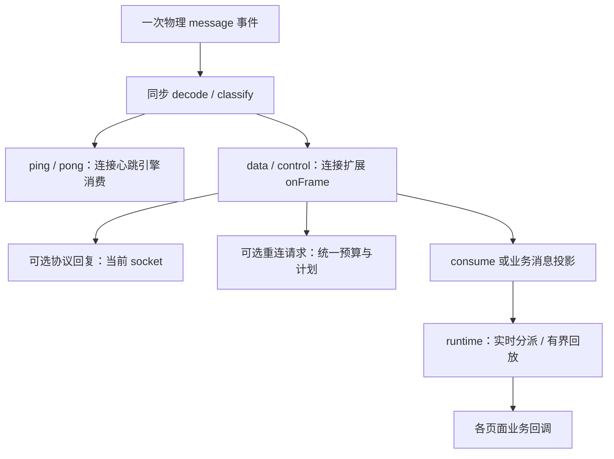

# Worker 协议处理与统一重连预算

本文补充并修订[运行时重设计](runtime-correctness-redesign.md)。需求是让应用在 Worker 内按共享连接处理自定义心跳、收到消息后的协议回复，以及消息触发的重连；页面只注册业务回调。用户已明确 Ack 指应用自定义的“前端已收到”回复，不要求库提供请求关联、服务端确认 Promise 或通用 RPC。以下 API 是已批准的目标契约，当前工作树正在按此实现；已发布的 0.1.0-beta.2 不具备这些新 API。

## 1. Review 结论

现有 `createExtension` 的连接作用域正确：工厂对一个 ConnectionEntry 只执行一次。现有 `filterInbound` 的能力不足：它只能决定业务帧是否继续派发，没有受约束的回复或重连入口。把这些操作放进页面 `onMessage` 再选一个 dispatch owner，会让协议正确性依赖页面参与和调度，不能满足本需求。

上一版重设计中“显式 reconnect 清空预算”也不成立：服务端每次发重连指令都可以重新获得三次机会。新的规则把触发来源与是否计数分开；页面、Worker 扩展和断线恢复共同使用连接控制器的一份预算。

应用仍拥有协议含义，但应用代码可以部署在 Worker。库提供同步帧处理、受限回复和重连计划能力，不预设 Ack 的字段、消息 ID、可靠投递或业务成功含义。决策见 [ADR 0009](../adr/0009-worker-protocol-actions-and-retry-budget.md)。

## 2. 协议处理位于 fan-out 之前



一个已接纳的原生入站帧只经过一次连接扩展，与标签页数量无关。Worker 的连接条目拥有扩展，runtime 调用扩展并执行其结果；controller 只提供与环境无关的发送和重连能力，不导入 Worker 或页面类型。

`ProtocolAdapter` 继续负责无状态、同步的 encode/decode/classify。分类结果增加 `{ type: 'control', data }`，表示应用协议控制帧。`data` 与 `control` 进入 `onFrame`；标准 `ping`、`pong`、`ignore`、`fatal` 由连接引擎消费，不再走第二条扩展处理路径。没有 `onFrame` 时，`data` 按原值派发，`control` 消费。

`ConnectionExtension<Decoded, Outgoing, Incoming = Decoded>` 区分解码值、协议出站值与页面业务值。其同步 `onFrame(frame, context)` 接收带 `data` 的 data/control 帧，返回以下形状：

```ts
/** 应用对当前入站帧的处理决定；所有效果都绑定当前物理尝试。 */
interface FrameResult<Incoming, Outgoing> {
  /** 明确消费当前帧，或向页面投影一个业务值。 */
  delivery:
    | { type: 'consume' }
    | { type: 'broadcast', data: Incoming }
  /** 可选的一条应用协议回复，经当前 adapter 编码。 */
  reply?: Outgoing
  /** 可选的一次重连请求；省略 countAsRetry 等同于 true。 */
  reconnect?: { countAsRetry?: boolean }
}
```

只保留一个连接帧处理入口，删除 `filterInbound`，不引入中间件链。原来的过滤逻辑改成返回 consume 或广播原值。业务投影最多一个、回复最多一个、重连请求最多一个，不建立效果数组或待执行 Promise 队列。广播值受既有 clone、单帧、delivery 与 replay 上限约束；consume 不占页面额度。

context 是包含 connectionEpoch、attempt 和当前安全连接快照的只读值，不提供原始 WebSocket 或页面 client。扩展实例可保存业务定义的连接期状态；`onSocketOpen`、新增的同步 `onSocketClose` 和 `dispose` 分别负责尝试初始化、尝试结束清理与条目回收。一次尝试的结束通知只执行一次；旧尝试不能清理新尝试状态。扩展自建状态的容量、过期和 Worker 重建恢复由应用负责。

### 2.1 自定义“已收到”回复

下面只展示拟议扩展处理器；`ServerMessage`、`ClientMessage`、`BusinessEvent` 和 Ack 字段均由应用定义，扩展通过既有自定义 Worker 的 `createExtension` 注册：

```ts
const extension: ConnectionExtension<ServerMessage, ClientMessage, BusinessEvent> = {
  onFrame(frame) {
    const message = frame.data
    switch (message.kind) {
      case 'notification':
        return {
          reply: { kind: 'received', messageId: message.id },
          delivery: { type: 'broadcast', data: message.event },
        }
      case 'refresh-connection':
        return {
          delivery: { type: 'consume' },
          reconnect: { countAsRetry: true },
        }
      case 'rotate-endpoint':
        return {
          delivery: { type: 'consume' },
          reconnect: { countAsRetry: false },
        }
      default:
        return { delivery: { type: 'consume' } }
    }
  },
}
```

三个标签页共享连接时，一条 notification 只生成一次 received 回复，业务事件可分别交给三个页面。该回复确认的是 Worker 的协议处理入口收到并识别了消息；不会等待任一页面回调、页面 receipt 或回放。后续页面消息被额度丢弃，也不撤销这个确认。协议若要求“业务完成后确认”，需要应用显式提交业务完成结果，不得使用本例冒充业务成功。

服务端重新发送同一业务消息，会产生新的原生帧并再次进入处理器；多 tab 不重复执行与服务端重传去重是两个契约。应用可以按自己的消息 ID 再次回复、抑制重复业务投影，库不自动建立去重表。

| 信号 | 确认内容 | 所有者 |
| --- | --- | --- |
| 本例 received / Ack | 应用定义的 Worker 收到与识别条件。 | 应用协议。 |
| sendMessage 的 accepted / queued | 原生 send 已本地接纳，或有界本地队列已接纳。 | SocketFuse 发送层。 |
| 页面 delivery receipt | 页面传输层取走一次投递，可归还 credit。 | SocketFuse 端口层。 |

### 2.2 心跳仍只有一个调度者

自定义 Worker 内的同步 adapter 定义心跳编码、ping/pong 分类与 `createPing/createPong`；connection 的现有心跳引擎负责间隔、超时及自动恢复。这样自定义 JSON 或二进制心跳同样每条物理连接执行一次，不需要页面注册回调或重复启动计时器。它们是 WebSocket 数据消息，浏览器原生 Ping/Pong 不在公开 API 内。

普通收到确认归 `onFrame`，不伪装成心跳 pong；标准 ping 由心跳引擎回复，扩展不能对同一帧再回复一次。若应用需要依赖跨帧协议状态生成心跳，则将同步 `createPing/createPong` 提供在连接扩展上，作为该连接唯一的心跳生成来源；这两个 hook 作为一组选择，不与 adapter 的生成函数逐项叠加。raw/JSON 及没有此组 hook 的 custom adapter 使用原有生成来源。心跳时钟、尝试守卫、发送限制和超时行为始终只有引擎一套；不允许扩展另起一个库管理的心跳循环。缺少启用模式所需的生成函数在条目创建时拒绝。

扩展心跳 hook 与 adapter 转换都必须同步。Promise/thenable 视为契约违例，安全消费 rejection 并终止当前连接，不自动重试相同无效实现。异步取凭据继续放在有界的 prepareAttempt；本需求不引入通用异步 Worker 任务执行器。

### 2.3 回复、错误与生命周期

协议回复复用心跳的当前尝试发送能力，经 encode、单帧大小和 bufferedAmount 检查后立即原生 send；不进入页面业务 FIFO、断线队列或 replay，也不能带到下一次 socket。业务发送之间的 FIFO 不变，协议控制回复可插入其间，但不能绕过单帧与背压限制。背压拒绝即报告安全错误，不新建无界高优先级队列。

runtime 在执行任何效果前验证整个结果和投影数据预算；随后按“尝试回复 → 业务投影 → 请求重连”处理，每次外部回调或原生调用后核对 attempt。回复失败报告错误，不声称服务端已经收到；若当前尝试仍有效，后续独立效果可继续。native send 异常已使尝试结束时，旧结果的后续效果全部停止。重连请求若被预算拒绝，不撤销已经接纳的回复或业务投影，也不关闭健康连接。

这些效果不是可回滚事务，不能保证 Ack 送达之后服务端才看到连接关闭。需要该保证的协议应等待服务端后续响应再提出重连。`onFrame` 抛错、返回无效结构或投影超限时消费当前帧、无效果并报告安全错误，不降级为原始控制消息广播；应用自行修改的闭包状态无法由库回滚。异步 onFrame 与其他同步协议 hook 一样属于终止性的契约违例。

页面暂停、回放、加入或离开不重新运行处理器。条目还有连接需求或处于 idle 宽限期且 socket 尚存时，协议处理继续；条目释放后扩展 dispose。custom Worker 按主规格禁止 direct fallback，避免部署在 Worker 的协议逻辑被静默跳过。

## 3. 所有重连入口共享一份预算

配置由旧的 `autoReconnect` 合并为连接级 `reconnect`，明确区分自动触发开关与重试限制：

```ts
reconnect: {
  automatic: true,
  maxRetries: 3,
  initialDelay: 1000,
  maxDelay: 30000,
  factor: 2,
  jitter: 0.2,
  stableThreshold: 30000,
  hookTimeout: 10000,
}
```

省略配置时 automatic 为 true、maxRetries 为 Infinity，其他默认值保持现有值。maxRetries 为非负安全整数或 Infinity；stableThreshold 为正整数毫秒或 false，false 表示不按稳定连接自动重置。其他数值沿用主规格的严格范围校验。整个配置进入共享 canonical；同一连接的页面不能采用不同预算。单次请求的 countAsRetry 属于计划输入，不进入共享配置。

`automatic: false` 只关闭断线、建连失败和心跳超时等引擎触发的恢复，不取消 Worker/页面显式请求的能力或其预算。`maxRetries: 0` 禁止任何计数重连，但首次连接和明确不计数的请求仍可启动。适配器的 shouldReconnect 只决定自动恢复许可，不控制应用显式重连，也不能更改计数策略；fatal/同步 hook 契约违例仍需销毁并重新创建条目，不能以不计数请求绕过终态。

| 入口 | 默认是否计数 | 能否显式不计数 |
| --- | --- | --- |
| 断线、建连失败、心跳超时后的自动恢复 | 是。 | 否。 |
| Worker onFrame 返回 reconnect | 是。 | `countAsRetry: false`。 |
| 页面 `ws.reconnect(options?)` | 是。 | `ws.reconnect({ countAsRetry: false })`。 |

首次实际建连不占预算。此后每次计数重连在调用原生 WebSocket 工厂之前扣一次，包括工厂同步抛错的尝试。提出请求、准备 URL、等待退避、等待旧 socket 结束、多个调用加入同一计划不扣次数。

### 3.1 接纳、合并与防止重复消耗

连接只有一个待决或正在启动的重连计划。接纳计数请求时先检查并预留预算，再结束原有健康连接；不能先断线后发现没有额度。只有真正启动才把预留转成已用次数，启动前取消释放预留。连接没有需求时不自行接受 Worker 重连请求；idle 宽限期可以回复当前 socket 的协议帧，但不会为了协议通知延长条目寿命。

同一当前连接状态上的重复请求加入已有计划，保留首个接纳的 countAsRetry、总准备期限、延迟和原因，不取消并重新运行 prepareAttempt。计数策略冲突时返回 `RECONNECT_IN_PROGRESS`；不得通过后来到达的不计数请求改写已接纳计划。准备事务一次提交后结束，但计划身份持续覆盖等待旧 socket 结束、退避及新 socket 的 connecting 阶段，直到新尝试 open、失败或被取消。计划启动后仍处于 connecting 时，相同请求加入该尝试，冲突请求拒绝，不反复拆掉 connecting socket。

页面控制请求携带最近已观测的 connectionEpoch 与 attempt/planId；runtime 只允许匹配当前尝试的请求或加入仍在进行的对应计划，过期请求返回稳定的 stale 错误，不重连一个已经替代旧尝试的新 open socket。并发请求在旧尝试已经成功替换后迟到，不得悄悄成为第二次重连。Worker 的 onFrame 请求直接携带当前物理尝试身份，不依赖页面状态缓存。

`reconnect()` 的 Promise 确认计划已接纳或加入，不等待网络 open；实际结果通过连接状态事件观察，等待 open 使用既有页面 waiter。请求回复丢失不自动重发或另建计划。被拒绝的请求 reject；Worker 效果没有跨帧 Promise，拒绝通过安全 error 通道报告。

旧 socket 因该计划关闭产生的 close 事件属于同一次替代，不再触发第二个自动计划。不计数尝试若启动后失败，后续自动恢复是一项新的计数请求，继续使用此前剩余额度。

### 3.2 预算用尽、重置与退避

已用次数达到 maxRetries 时，计数请求返回既有 `RETRY_EXHAUSTED`；健康 socket 保持原状，已断线的连接停止自动尝试。预算耗尽本身不使条目进入不可恢复终态；不计数请求仍可接纳，但不会减少 retriesUsed、补足额度或改变下一次自动重试的序号。因此 maxRetries 限制的是计数尝试，显式豁免存在时不承诺物理连接总数最多为该值。

预算只在以下情况下从零开始：当前物理连接连续 open 达到 stableThreshold，或条目被完整回收后创建新的 connectionEpoch。稳定窗口须绑定当前 attempt，断线及 connecting 时间不累计；stableThreshold:false 可用于要求同一条目生命周期内累计最多三次的场景。新标签页加入、页面 close/reopen、换 URL、显式重连以及不计数重连均不直接重置预算。

处理重连请求时先按当前连续 open 时长结算已经达到的稳定窗口，再检查额度；只有计划接纳才封存该稳定窗口并撤掉 timer。之后等待关闭、准备和退避不再延长旧窗口，也不能清掉已经预留的额度。被拒绝的请求保持原健康连接的稳定 timer，不阻止它以后按正常条件恢复预算。

计数计划的默认退避按“当前 retriesUsed + 1”计算；不计数计划默认延迟为 0。延迟与计数仍是两个独立维度：prepareAttempt / onBeforeReconnect 可按现有规则 setDelay(0)，实现立即执行但照常扣次数；这些准备方不能修改 countAsRetry、maxRetries 或已用次数。准备上下文新增只读 source、countAsRetry、retriesUsed，保留物理 attempt 与默认延迟；source 为库定义枚举，不把服务端 payload 当作错误原因或日志。

diagnostics 区分 connectionEpoch、包含首次和不计数尝试的单调 attempt，以及 retriesUsed、retriesRemaining、retryReserved。retryReserved 为 0 或 1，retriesRemaining 是扣除已用和预留后可接纳的计数次数；Infinity 仍为 Infinity。不计数计划不占预留；稳定窗口重置不影响 attempt 编号。

### 3.3 三次预算示例

以下事件处于同一 connectionEpoch，期间均未达到稳定重置条件，每项“启动”表示已经调用 socket 工厂：

| 事件 | retriesUsed | 结果 |
| --- | --- | --- |
| 首次连接 | 0 | 启动。 |
| 断线后自动重连 | 1 | 启动计数尝试。 |
| Worker 收到协议指令，countAsRetry:true | 2 | 启动计数尝试。 |
| Worker 收到协议指令，countAsRetry:false | 2 | 启动不计数尝试。 |
| 断线后自动重连 | 3 | 启动最后一次计数尝试。 |
| 再次自动恢复或默认显式重连 | 3 | RETRY_EXHAUSTED，不启动。 |
| 显式 countAsRetry:false | 3 | 可启动；若失败，自动恢复仍无预算。 |

## 4. 验收与迁移

实现时移除旧 filterInbound、显式重连清零及 autoReconnect 配置分支；更新控制协议、公开入口类型、共享 canonical、主规格和模块 README。协议 adapter 的 Incoming 泛型说明改为解码值；页面 Incoming 明确是扩展投影后的业务值。扩展与 adapter 的类型通过 Worker 注册入口约束，示例不得依赖 any 串接互不兼容的协议。

必须加入以下行为测试，预算状态机在同一 runtime 的 shared/direct 接入下共用契约测试；Worker 自定义逻辑另做真实多页验证：

1. 三个页面共享连接，每个原生通知只回一个自定义 Ack；所有页面可收到业务投影。暂停、恢复、replay 和新页面加入不再次回 Ack；服务端重发按新帧处理。
2. 自定义 ping/pong 只经过一个心跳调度者；扩展的状态型生成器按连接隔离，不与 adapter 生成器同时调用；旧尝试计时器不发送到新 socket。
3. consume 的协议帧不进入页面 data、handler 或 replay；onFrame 抛错/无效结果不把控制 payload 放行；异步 hook 终止当前连接且无未处理 rejection。
4. 回复背压、超大输出、encode/native send 失败、旧 attempt 和 dispose 均不产生跨尝试回复；成功的本地 send 不被断言为网络送达。
5. 自动、Worker 和页面计数请求共同达到三次上限；不计数前后保持原计数；自动开关关闭仍允许显式计数请求，maxRetries:0 拒绝计数请求。
6. 同一计划期间同时到达的请求、重复协议指令及延迟控制消息不会重复扣数或拆掉新连接；冲突计数策略拒绝；计划取消、准备超时回退和工厂抛错各按实际启动次数结算。
7. 替代旧 socket 的 close 不另扣数；不计数尝试失败后的自动重试扣数；耗尽预算拒绝时原健康连接保持。
8. 连续稳定 open 才重置；旧 open timer、connecting 时间、页面重新加入或显式重连均不重置；false 禁用稳定重置，新 epoch 才重新开始。
9. Worker 回收重建、共享配置冲突、custom Worker 初始化失败均遵守主规格的连接身份和不降级约束。

本轮只更新设计；测试清单不是已实现或已通过的新功能声明。
